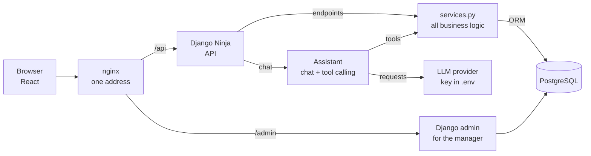
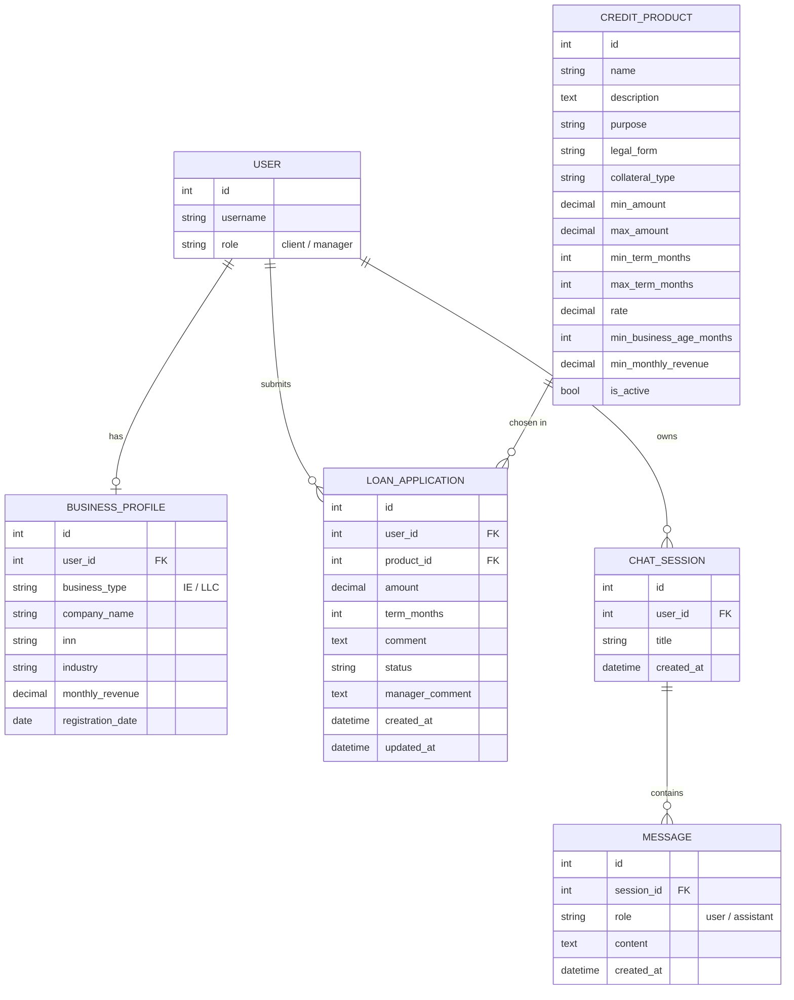
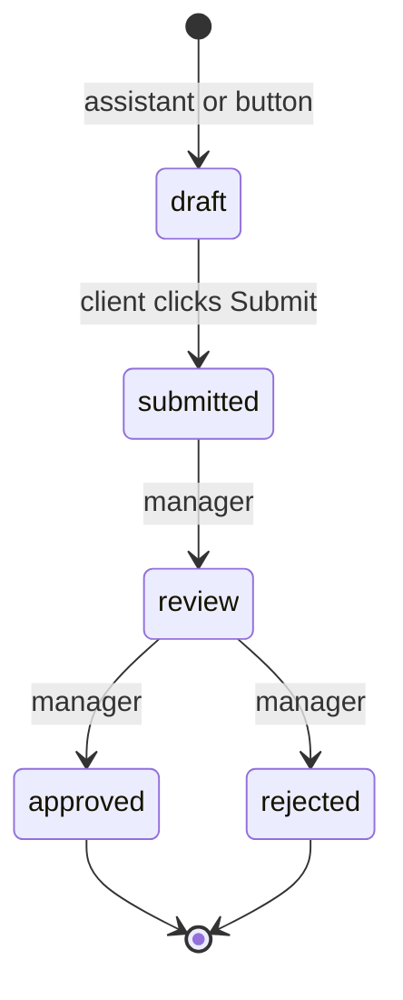
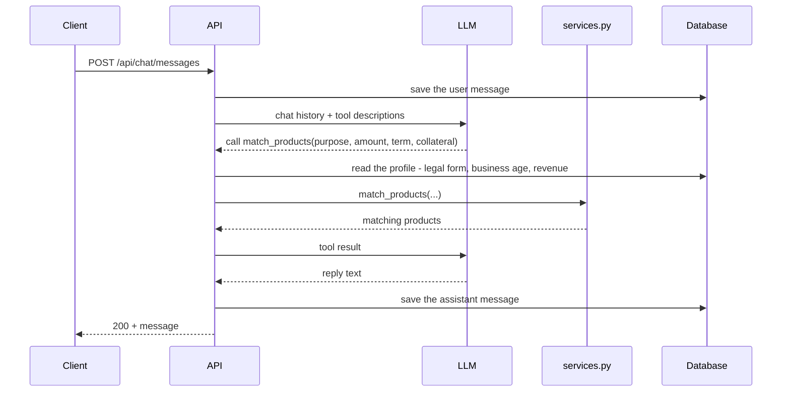

<div align="center">

<h1>
  Smart Credit <span style="color:#EF3124;">Cabinet</span>
</h1>

<h3>
  A credit cabinet for small business owners with an AI assistant: it finds out what you need, picks a loan, calculates the payment and prepares the application
</h3>

<p>
  
  
  
  
  
  
</p>

<p>
  Alfa-Bank hackathon «Alfa-Future» · case «Smart Credit Cabinet for Entrepreneurs» · Small and micro business track
</p>

<p>
  README is available in:
  <a href="./README.ru.md">Russian</a> ·
  <a href="./README.md">English</a>
</p>

</div>

---

## Navigation

- [Project Status](#project-status)
- [About the Project](#about-the-project)
- [Tech Stack](#tech-stack)
- [Architecture](#architecture)
- [Userflow](#userflow)
- [Roles](#roles)
- [Data Model](#data-model)
- [API](#api)
- [Frontend Contract](#frontend-contract)
- [AI Assistant](#ai-assistant)
- [Security Principles](#security-principles)
- [Quick Start](#quick-start)
- [Tests and CI](#tests-and-ci)
- [Project Structure](#project-structure)
- [Roadmap](#roadmap)

---

## Project Status

🚧 In active development — a hackathon project, deadline **October 26, 2026**.

Done: the monorepo skeleton — a Django 6.1 project managed by uv, settings via `django-environ` with a single `.env` in the repo root, PostgreSQL 18 in Docker Compose (`db` + `migrate` + `web`), a Dockerfile, pre-commit hooks adapted to the monorepo, and GitHub Actions CI (ruff, a migrations check, pytest on PostgreSQL) with a smoke test. Next up: the `users` app — a custom User with roles, session-based login and the business profile.

Below is an honest account of what already works and what's planned (see [Roadmap](#roadmap)). Every endpoint in the [API](#api) table is marked with its real status.

---

## About the Project

A personal cabinet for an entrepreneur. Instead of filling in long forms, the client talks to an AI assistant: it asks what the money is for, how much and for how long, picks matching loan products, calculates the monthly payment and prepares a draft application. The client sends it with one click and then sees the bank's decision.

Three ideas hold the project together:

- **The assistant talks, the code acts.** The model never touches the database. It asks the backend to call a function (tool calling), and the backend decides what's allowed and executes it.
- **One source of business logic.** Matching, payment calculation and application creation live once in `services.py`. Frontend buttons and assistant tools call the very same functions.
- **Human in the loop.** The assistant only creates a draft and asks for confirmation first. Sending the application is always the client's own action.

---

## Tech Stack

| Layer | Technologies |
| --- | --- |
| **Backend** | Django 6.1, Django Ninja |
| **Database** | PostgreSQL 18 |
| **Authentication** | Django sessions (`django_auth` in Ninja) + CSRF token in the `X-CSRFToken` header, no JWT |
| **AI** | LLM with tool calling: `match_products`, `calculate_payment`, `create_application` |
| **Manager's cabinet** | Django admin |
| **Frontend** | React (a teammate's area, same repository) |
| **Tests** | pytest-django |
| **Infrastructure** | Docker Compose (`db` + `migrate` + `web`), gunicorn; nginx and deployment are planned |
| **CI** | GitHub Actions |
| **Package manager** | uv (`pyproject.toml` + `uv.lock`) |
| **Linter & formatter** | ruff + pre-commit |

---

## Architecture

The frontend and the API live on one address: nginx serves React and forwards `/api` to Django. During development, Vite does the same with a proxy.



Frontend buttons and assistant tools lead into the same `services.py`, so matching, calculation and application creation are written exactly once.

---

## Userflow

The demo consists of six scenes. **The MVP is ready when all six work on the deployed server.**

1. **Sign-up and login.** `POST /api/auth/register` creates a user with the `client` role and logs them in right away. From then on the backend knows the user by the session.
2. **Business profile.** The frontend calls `GET /api/profile`: a `404` means "no profile yet", and onboarding is shown. `PUT /api/profile` saves the legal form, INN, industry, revenue and registration date.
3. **Chat.** `POST /api/chat/messages` saves the client's message, sends the history to the LLM and saves the assistant's reply.
4. **Matching and calculation.** The model clarifies the purpose, amount, term and collateral, then calls the "match products" and "calculate payment" tools. Profile data is filled in by our code from the database, not by the model.
5. **Application.** After the client's explicit "yes", the model calls "create application" and a draft appears. The client opens it and clicks "Submit": `POST /api/applications/{id}/submit` moves it to `submitted`.
6. **Decision.** In the admin, the manager sets `review`, then `approved` or `rejected`, and writes a comment. The client sees the status and the reason via `GET /api/applications/{id}`.

---

## Roles

| Who | How it's set | What they can do |
| --- | --- | --- |
| **Client** | `role=client`, set by the backend on sign-up | Their own profile, chat and applications |
| **Manager** | `role=manager` + `is_staff=True` + the «Managers» group | In the admin: views applications, changes status, writes a comment |
| **Admin** | `createsuperuser` (`is_superuser`) | Everything: products, users, applications |

Why there is no `role=admin`: two fields describing the same thing will drift apart sooner or later. An admin is simply a Django superuser.

---

## Data Model

Six models in four apps.

- **Money** is stored in `DecimalField` and returned by the API as a string.
- **Dates** are stored as dates, not as durations: the business age is computed from `registration_date`.
- **Product requirements** are separate fields, so matching is a plain database filter.
- **INN** is a string: it's a code, not a number.



| Product field | Values |
| --- | --- |
| `purpose` | working capital / equipment / development / refinancing |
| `legal_form` | IE / LLC / any |
| `collateral_type` | no collateral / property pledge / guarantee fund |

### Application Lifecycle



- A **draft** is created by the assistant (after confirmation) or by a button.
- **`draft → submitted`** is the only transition the client makes, through the `submit` action. The server first checks that the application is theirs and is still a draft.
- **Everything after that** is the manager's job in the admin. `manager_comment` explains the decision to the client.

---

## API

Base prefix — `/api/`. 15 endpoints in the MVP, each one backs a specific screen or user action.

| Method | Endpoint | Description | Status |
| --- | --- | --- | --- |
| `GET` | `/api/auth/csrf` | Sets the CSRF cookie | 📋 |
| `POST` | `/api/auth/register` | Sign up with `role=client` and log in | 📋 |
| `POST` | `/api/auth/login` | Log in | 📋 |
| `POST` | `/api/auth/logout` | Log out | 📋 |
| `GET` | `/api/auth/me` | Current user; the frontend checks whether someone is logged in | 📋 |
| `GET` | `/api/profile` | My business profile; `404` — no profile yet | 📋 |
| `PUT` | `/api/profile` | Create or update the profile | 📋 |
| `GET` | `/api/products` | Catalogue of active products | 📋 |
| `GET` | `/api/products/{id}/calculate?amount=&term=` | Monthly payment for the calculator | 📋 |
| `POST` | `/api/applications` | Create an application (`draft`) with a button | 📋 |
| `GET` | `/api/applications` | My applications | 📋 |
| `GET` | `/api/applications/{id}` | One of my applications; used by the «Open application» button in the chat | 📋 |
| `POST` | `/api/applications/{id}/submit` | Send for review: `draft → submitted` | 📋 |
| `GET` | `/api/chat/messages` | My chat history | 📋 |
| `POST` | `/api/chat/messages` | Send a message and get the assistant's reply | 📋 |

✅ done · 🚧 in progress · 📋 planned

Deliberately left out: `/products/match` (matching only through the assistant), `/products/{id}` (the catalogue already returns every field) and a list of chats (one chat per user).

Live documentation — Swagger at `/api/docs`, generated by Ninja from the schemas.

---

## Frontend Contract

### Rules

- Before the first `POST`, the frontend calls `GET /api/auth/csrf` and then sends the token from the `csrftoken` cookie in the `X-CSRFToken` header.
- Requests go to the same address (`/api`); the browser sends the session cookie by itself.
- The user ID is never passed in the URL or the body — the backend takes it from the session.
- The frontend never sends `role` or `status`; the backend doesn't accept them.
- Money comes as a string (`"40521.50"`) so no precision is lost.
- The assistant's reply arrives as a regular `POST` response within a few seconds. The frontend shows «typing…»; there's no streaming.

### Response codes

| Code | When |
| --- | --- |
| `200` / `201` | Success / object created |
| `400` | The action isn't allowed, e.g. `submit` not from `draft` |
| `401` | The user isn't logged in |
| `403` | The CSRF token is missing |
| `404` | The object doesn't exist or belongs to someone else |
| `422` | The data failed schema validation |

### Example: a chat message

```http
POST /api/chat/messages
```

```json
{"content": "I need 800 thousand for coffee shop equipment"}
```

Response:

```json
{
  "id": 42,
  "role": "assistant",
  "content": "I've found two options...",
  "created_at": "2026-10-20T12:30:00Z",
  "application_id": null
}
```

If the assistant has created a draft, `application_id` holds its id, and the frontend shows an «Open application» button.

### Example: payment calculation

```http
GET /api/products/3/calculate?amount=800000&term=24
```

With a product rate of 19.5% per year:

```json
{
  "monthly_payment": "40521.50",
  "total": "972516.00",
  "overpayment": "172516.00"
}
```

The payment is an **annuity** — the same amount every month:

```
payment = S · r · (1 + r)^n / ((1 + r)^n − 1)

S — loan amount, n — term in months, r — monthly rate = annual rate / 12 / 100
```

---

## AI Assistant

The model runs the conversation; actions are performed by our code through tool calling. The model asks for a function to be called, the backend runs it and returns the result, and the model turns the result into a reply.

| Tool | Parameters from the model (the client's words) | Taken by our code | Returns |
| --- | --- | --- | --- |
| `match_products` | `purpose`, `amount`, `term_months`, `collateral` | Legal form, business age and revenue from the profile | Matching products |
| `calculate_payment` | `product_id`, `amount`, `term_months` | The rate from the database | Payment, total, overpayment |
| `create_application` | `product_id`, `amount`, `term_months`, `comment` | The user from the session | A draft application |



Rules the assistant follows:

- **Before `create_application`** it asks the client for confirmation.
- **It only creates a draft.** Sending the application is the client's decision — human in the loop.
- **Collateral is asked in the chat.** It belongs to the current request, not to the business.
- **The profile stores what's stable about the business; the chat collects what's about the current need.**
- **Only `user` and `assistant` messages are stored.** The system prompt lives in the code.

**Fallback plan:** if tool calling doesn't work out, the assistant gives advice in plain text, and the application is created with a button via `POST /api/applications`.

---

## Security Principles

The main rule: **we don't trust what the client or the model sends when rights or money depend on it.**

- The role on sign-up is always `client`; the `role` field from the request is never accepted.
- The user in the assistant's tools comes from the session, not from the model.
- The application status is changed only by the server through the `submit` action, after checking that the application belongs to the user and is a draft.
- Own objects are always looked up with a `request.user` filter. Someone else's object returns `404`, as if it didn't exist.
- Passwords are checked with Django's built-in `validate_password`.
- The LLM key lives only in `.env` and never gets into the repository.

---

## Quick Start

```bash
git clone <repository-url>
cd credit-cabinet
cp .env.example .env        # then put your own SECRET_KEY into it
```

Generate a key (letters, digits, `-` and `_` only — `$` and `#` get misread by `.env` parsers):

```bash
uv run --directory backend python -c "import secrets; print(secrets.token_urlsafe(50))"
```

> ⚠️ **Temporary:** until the project has its own User model, don't run `migrate` (and don't start the full compose — the `migrate` service would run it). This note goes away together with the `users` app.

### Option 1 — development (database in Docker, Django locally)

```bash
docker compose up -d db     # starts only PostgreSQL
cd backend
uv sync --all-groups        # dev/test dependencies live in separate groups
uv run manage.py migrate
uv run manage.py runserver
```

### Option 2 — everything in Docker

```bash
docker compose up -d --build
```

The `migrate` service waits for the database, applies migrations and exits; `web` starts only after it succeeds. The code is attached via a bind mount (`compose.override.yaml`), so changes are picked up immediately; a rebuild is only needed when dependencies change.

Admin panel — `http://127.0.0.1:8000/admin/`.

### Database

PostgreSQL 18 in Docker: the `db` service in `compose.yaml`, named volume `pg_data`. The port is published only on `127.0.0.1:5432`. Credentials come from `.env` (`POSTGRES_USER`, `POSTGRES_PASSWORD`, `POSTGRES_DB`) and are required — without them `docker compose` fails right away.

Locally Django reaches the database at `localhost`; inside the compose network — by the service name `db`, so compose builds `DATABASE_URL` for the containers on its own.

> ⚠️ `docker compose down -v` deletes the `pg_data` volume together with all the data in it.

### pre-commit

Git hooks don't come with `git clone`, so after cloning run once:

```bash
uv tool install pre-commit
pre-commit install
```

---

## Tests and CI

From `backend/`, with the database running:

```bash
uv run pytest
uv run ruff check .
uv run ruff format --check .
```

> pytest has to be run from `backend/`: that's where its settings live (`[tool.pytest.ini_options]` in `pyproject.toml`). Run from the repo root, tests that need the database are silently skipped.

**pre-commit** (on every commit): YAML/TOML checks, a private key detector, whitespace fixes, a ban on committing to `main`, ruff on `backend/` and `uv lock` for the `backend` project.

**CI** (GitHub Actions, `.github/workflows/ci.yml`) — on every pull request and every push to `main`:

1. `ruff check` + `ruff format --check`
2. `makemigrations --check` — catches forgotten migrations
3. `pytest` on a `postgres:18` service

An OpenAPI schema check will be added once the first endpoints appear.

---

## Project Structure

```
credit-cabinet/
├── backend/
│   ├── config/              # settings, urls, asgi/wsgi
│   ├── apps/                # Django apps: users, products, applications, assistant
│   ├── tests/               # smoke test
│   ├── Dockerfile           # Django image (uv, gunicorn)
│   ├── .dockerignore        # keeps .venv, .env and caches out of the image
│   ├── manage.py
│   ├── pyproject.toml       # dependencies, ruff and pytest settings
│   └── uv.lock
├── frontend/                # React app
├── .github/workflows/ci.yml # CI: ruff, migrations check, pytest on PostgreSQL
├── compose.yaml             # db (PostgreSQL) + migrate + web (Django)
├── compose.override.yaml    # dev: bind mount, runserver, database port
├── .env.example             # environment variables template
└── .pre-commit-config.yaml  # hooks adapted to the monorepo
```

---

## Roadmap

- [x] Skeleton: monorepo, uv, Django, settings via `.env`, Docker Compose + PostgreSQL, pre-commit, CI
- [ ] `users`: custom User with roles, sign-up and session login, CSRF, `BusinessProfile`
- [ ] `products`: `CreditProduct`, catalogue, payment calculator, matching in `services.py`
- [ ] `applications`: create, list, detail, `submit`, the manager's admin
- [ ] `assistant`: chat stored in the database, LLM replies
- [ ] Tool calling: `match_products`, `calculate_payment`, `create_application`
- [ ] Frontend integration, the assistant's prompt
- [ ] Deployment: Docker Compose + nginx, demo run-through
- [ ] Killer feature: bank statement upload → AI fills in the profile
- [ ] Spare time: rule-based pre-scoring, demo polish

### Killer feature: AI reads a bank statement

The client uploads an account statement, and the assistant finds the revenue in it and fills in the profile by itself. A file comes in through `UploadedFile` in Ninja → text is extracted from the PDF with `pypdf` → the LLM returns the data in a strict format → `BusinessProfile` is updated. A new endpoint, e.g. `POST /api/profile/statement`. It's built only after the MVP: without a working chat it's pointless.

### Out of Scope

- A separate manager's cabinet (the admin covers it)
- JWT
- Integrations with real bank systems
- Training our own ML model
- Pagination, a list of chats, response streaming

---

<div align="center">
  <p>Alfa-Bank hackathon «Alfa-Future» · October 2026</p>
</div>
