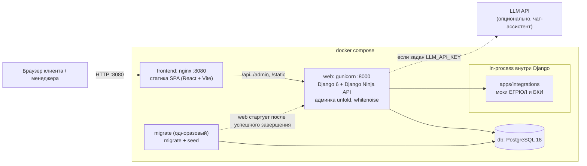
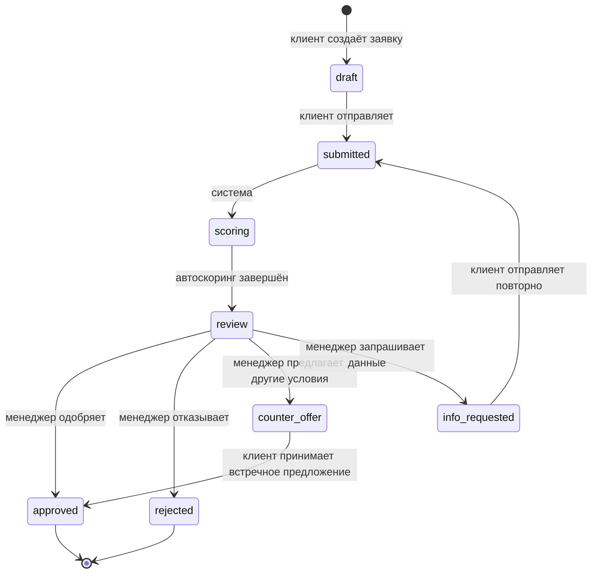
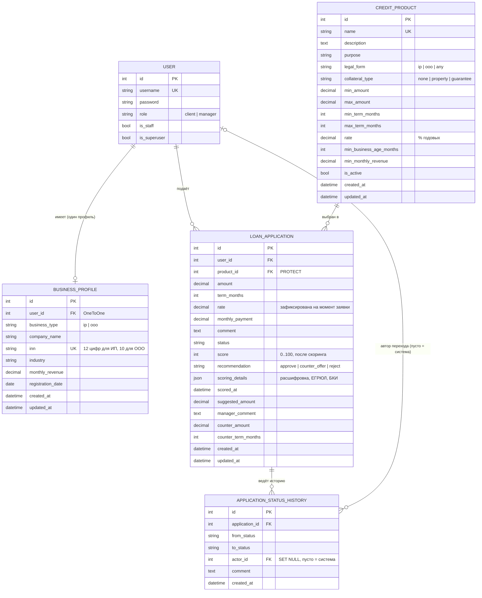

# Архитектура

Три диаграммы: схема развёртывания, жизненный цикл заявки и модель данных.
Диаграммы написаны в Mermaid и отображаются в GitLab, GitHub и большинстве редакторов Markdown.

## 1. Развёртывание (docker compose)

Что важно знать:

- Единственная публичная точка входа для пользователя - nginx на порту 8080. Он отдаёт собранную SPA, а запросы на `/api`, `/admin` и `/static` проксирует в `web:8000`.
- Статику админки раздаёт сам Django через whitenoise, поэтому общий volume с nginx не нужен.
- Сервис `migrate` применяет миграции и запускает идемпотентный `seed`; сервис `web` стартует только после его успешного завершения.
- Проверки ЕГРЮЛ и БКИ - детерминированные функции в `backend/apps/integrations/checks.py`, а не сетевые вызовы.
- LLM нужна только чат-ассистенту (`POST /api/assistant/chat`). Без `LLM_API_KEY` ассистент отвечает 503, остальные функции работают.
- Бэкенд также опубликован напрямую на `127.0.0.1:8000`, PostgreSQL в dev-режиме (через `compose.override.yaml`) - на `127.0.0.1:5432`.

## 2. Статусы заявки

Переходы взяты из `TRANSITIONS` в `backend/apps/applications/services.py`.

Пояснения:

- Переходы `draft -> submitted -> scoring -> review` выполняются одним вызовом `POST /api/applications/{id}/submit`: система отправляет заявку, запускает скоринг и переводит её на рассмотрение менеджеру. Каждый шаг пишется в историю статусов.
- Решение принимает менеджер в админке (`decide`): одобрить, отказать, встречное предложение или запрос данных. Рекомендация скоринга носит совещательный характер.
- Из `counter_offer` клиент может только принять предложение (`accept-offer`). Отдельного перехода «клиент отказался» в коде нет.
- `rejected` и `approved` - конечные статусы, других переходов из них нет.

## 3. Модель данных

Поля и связи взяты из `backend/apps/*/models.py`.

Ограничения БД (`CheckConstraint`): ИНН должен соответствовать типу бизнеса (12 цифр для ИП, 10 для ООО), оборот неотрицательный, диапазоны суммы и срока продукта корректны, ставка в диапазоне (0; 100), сумма и срок заявки положительны.
