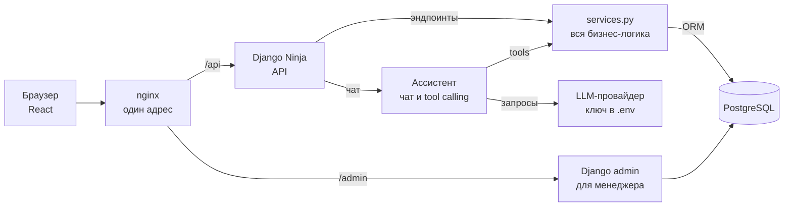
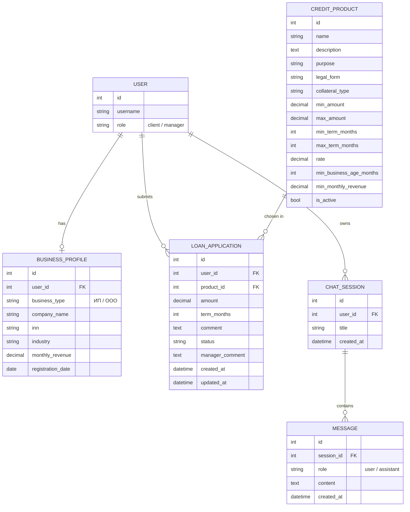
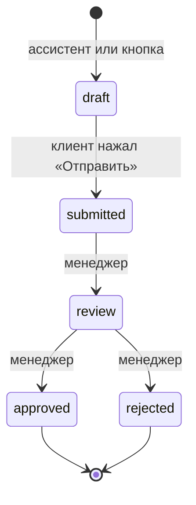
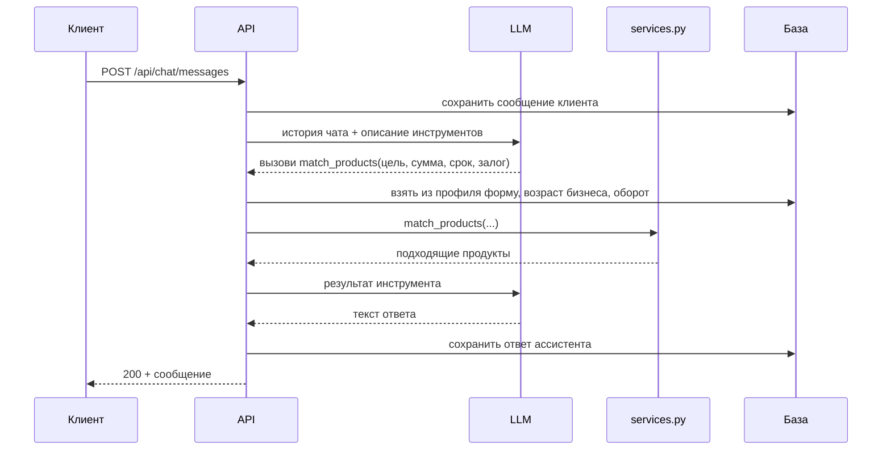

<div align="center">

<h1>
  Умный кредитный <span style="color:#EF3124;">кабинет</span>
</h1>

<h3>
  Кабинет предпринимателя с ИИ-ассистентом: выясняет потребность, подбирает кредит, считает платёж и готовит заявку
</h3>

<p>
  
  
  
  
  
  
</p>

<p>
  Хакатон Альфа-Банка «Альфа-Будущее» · кейс «Умный кредитный кабинет предпринимателя» · направление «Малый и микробизнес»
</p>

<p>
  README доступен на:
  <a href="./overview.ru.md">Русском</a> ·
  <a href="./overview.en.md">English</a>
</p>

</div>

---

## Навигация

- [Статус проекта](#статус-проекта)
- [О проекте](#о-проекте)
- [Стек](#стек)
- [Архитектура](#архитектура)
- [Userflow](#userflow)
- [Роли](#роли)
- [Модель данных](#модель-данных)
- [API](#api)
- [Контракт для фронтенда](#контракт-для-фронтенда)
- [ИИ-ассистент](#ии-ассистент)
- [Принципы безопасности](#принципы-безопасности)
- [Быстрый запуск](#быстрый-запуск)
- [Тесты и CI](#тесты-и-ci)
- [Структура](#структура)
- [Roadmap](#roadmap)

---

## Статус проекта

🚧 В активной разработке — проект для хакатона, дедлайн **26 октября 2026**.

Закрыто: скелет монорепы — Django 6.1 под управлением uv, настройки через `django-environ` и единый `.env` в корне репы, PostgreSQL 18 в Docker Compose (`db` + `migrate` + `web`), Dockerfile, pre-commit-хуки под монорепу и CI на GitHub Actions (ruff, проверка миграций, pytest на PostgreSQL) со smoke-тестом. Следующий шаг: приложение `users` — своя модель User с ролями, вход по сессиям и профиль бизнеса.

Ниже — честное описание того, что уже работает, и что запланировано (см. [Roadmap](#roadmap)). У каждого эндпоинта в таблице [API](#api) указан реальный статус.

---

## О проекте

Личный кабинет предпринимателя. Вместо длинных анкет клиент разговаривает с ИИ-ассистентом: тот спрашивает, на что нужны деньги, сколько и на какой срок, подбирает подходящие кредитные продукты, считает ежемесячный платёж и готовит черновик заявки. Клиент отправляет её одной кнопкой и потом видит решение банка.

Проект держится на трёх идеях:

- **Ассистент говорит, действует код.** Модель не трогает базу данных. Она просит бэкенд вызвать функцию (tool calling), а бэкенд сам решает, что можно, и выполняет.
- **Один источник бизнес-логики.** Подбор, расчёт платежа и создание заявки живут один раз в `services.py`. Кнопки фронта и инструменты ассистента вызывают одни и те же функции.
- **Human in the loop.** Ассистент только создаёт черновик и сначала спрашивает подтверждение. Отправить заявку — всегда действие самого клиента.

---

## Стек

| Слой | Технологии |
| --- | --- |
| **Backend** | Django 6.1, Django Ninja |
| **База данных** | PostgreSQL 18 |
| **Аутентификация** | Сессии Django (`django_auth` в Ninja) + CSRF-токен в заголовке `X-CSRFToken`, без JWT |
| **ИИ** | LLM с tool calling: `match_products`, `calculate_payment`, `create_application` |
| **Кабинет менеджера** | Django admin |
| **Frontend** | React (зона тиммейта, та же репа) |
| **Тесты** | pytest-django |
| **Инфраструктура** | Docker Compose (`db` + `migrate` + `web`), gunicorn; nginx и деплой — в планах |
| **CI** | GitHub Actions |
| **Пакетный менеджер** | uv (`pyproject.toml` + `uv.lock`) |
| **Линтер и форматтер** | ruff + pre-commit |

---

## Архитектура

Фронт и API живут на одном адресе: nginx отдаёт React и передаёт `/api` в Django. При разработке то же самое делает proxy в Vite.



Кнопки фронта и инструменты ассистента ведут в один `services.py`, поэтому логика подбора, расчёта и создания заявки пишется ровно один раз.

---

## Userflow

Демо состоит из шести сцен. **MVP готов, когда все шесть работают на задеплоенном сервере.**

1. **Регистрация и вход.** `POST /api/auth/register` создаёт пользователя с ролью `client` и сразу логинит его. Дальше бэкенд узнаёт пользователя по сессии.
2. **Профиль бизнеса.** Фронт вызывает `GET /api/profile`: ответ `404` значит «профиля нет», и показывается онбординг. `PUT /api/profile` сохраняет форму бизнеса, ИНН, отрасль, оборот и дату регистрации.
3. **Чат.** `POST /api/chat/messages` сохраняет сообщение клиента, отправляет историю в LLM и сохраняет ответ ассистента.
4. **Подбор и расчёт.** Модель уточняет цель, сумму, срок и залог, затем вызывает инструменты «подобрать продукты» и «посчитать платёж». Данные профиля подставляет наш код из БД, а не модель.
5. **Заявка.** После явного «да» клиента модель вызывает «создать заявку», и появляется черновик. Клиент открывает его и нажимает «Отправить»: `POST /api/applications/{id}/submit` переводит его в `submitted`.
6. **Решение.** Менеджер в админке ставит `review`, затем `approved` или `rejected` и пишет комментарий. Клиент видит статус и причину через `GET /api/applications/{id}`.

---

## Роли

| Кто | Как задаётся | Что может |
| --- | --- | --- |
| **Клиент** | `role=client`, ставит бэкенд при регистрации | Свой профиль, чат, свои заявки |
| **Менеджер** | `role=manager` + `is_staff=True` + группа «Менеджеры» | В админке смотрит заявки, меняет статус, пишет комментарий |
| **Админ** | `createsuperuser` (`is_superuser`) | Всё: продукты, пользователи, заявки |

Почему без `role=admin`: два поля про одно и то же рано или поздно разойдутся. Админ — это просто суперпользователь Django.

---

## Модель данных

Шесть моделей в четырёх приложениях.

- **Деньги** храним в `DecimalField`, в API отдаём строкой.
- **Даты** храним как даты, а не как сроки: возраст бизнеса вычисляется из `registration_date`.
- **Требования продукта** — отдельные поля, поэтому подбор — это обычный фильтр в базе.
- **ИНН** — строка: это код, а не число.



| Поле продукта | Значения |
| --- | --- |
| `purpose` | оборотные средства / оборудование / развитие / рефинансирование |
| `legal_form` | ИП / ООО / любая форма |
| `collateral_type` | без залога / залог имущества / поручительство фонда |

### Жизненный цикл заявки



- **Черновик** создаёт ассистент (после подтверждения) или кнопка.
- **`draft → submitted`** — единственный переход, который делает клиент, через действие `submit`. Сервер сначала проверяет, что заявка своя и всё ещё черновик.
- **Всё дальше** делает менеджер в админке. `manager_comment` объясняет клиенту причину решения.

---

## API

Базовый префикс — `/api/`. В MVP 15 эндпоинтов, за каждым стоит конкретный экран или действие пользователя.

| Метод | Эндпоинт | Описание | Статус |
| --- | --- | --- | --- |
| `GET` | `/api/auth/csrf` | Выдаёт CSRF-cookie | 📋 |
| `POST` | `/api/auth/register` | Регистрация с `role=client` и сразу вход | 📋 |
| `POST` | `/api/auth/login` | Вход | 📋 |
| `POST` | `/api/auth/logout` | Выход | 📋 |
| `GET` | `/api/auth/me` | Текущий пользователь; фронт проверяет, вошёл ли он | 📋 |
| `GET` | `/api/profile` | Мой профиль бизнеса; `404` — профиля ещё нет | 📋 |
| `PUT` | `/api/profile` | Создать или обновить профиль | 📋 |
| `GET` | `/api/products` | Каталог активных продуктов | 📋 |
| `GET` | `/api/products/{id}/calculate?amount=&term=` | Ежемесячный платёж для калькулятора | 📋 |
| `POST` | `/api/applications` | Создать заявку (`draft`) кнопкой | 📋 |
| `GET` | `/api/applications` | Мои заявки | 📋 |
| `GET` | `/api/applications/{id}` | Одна моя заявка; нужна для кнопки «Открыть заявку» из чата | 📋 |
| `POST` | `/api/applications/{id}/submit` | Отправить на рассмотрение: `draft → submitted` | 📋 |
| `GET` | `/api/chat/messages` | История моего чата | 📋 |
| `POST` | `/api/chat/messages` | Отправить сообщение и получить ответ ассистента | 📋 |

✅ готово · 🚧 в работе · 📋 запланировано

Убрали намеренно: `/products/match` (подбор только через ассистента), `/products/{id}` (каталог и так отдаёт все поля) и список чатов (один чат на пользователя).

Живая документация — Swagger на `/api/docs`, её собирает сам Ninja из схем.

---

## Контракт для фронтенда

### Правила

- Перед первым `POST` фронт вызывает `GET /api/auth/csrf` и дальше шлёт токен из cookie `csrftoken` в заголовке `X-CSRFToken`.
- Запросы идут на тот же адрес (`/api`), cookie сессии браузер отправляет сам.
- ID пользователя в URL и теле не передаём — бэкенд берёт его из сессии.
- Поля `role` и `status` фронт не присылает, бэкенд их не принимает.
- Деньги приходят строкой (`"40521.50"`), чтобы не терять точность.
- Ответ ассистента приходит обычным ответом на `POST` за несколько секунд. Фронт показывает «печатает…», стриминга нет.

### Коды ответов

| Код | Когда |
| --- | --- |
| `200` / `201` | Успех / объект создан |
| `400` | Действие недопустимо, например `submit` не из `draft` |
| `401` | Пользователь не вошёл |
| `403` | Не передан CSRF-токен |
| `404` | Объекта нет или он чужой |
| `422` | Данные не прошли проверку схемы |

### Пример: сообщение в чат

```http
POST /api/chat/messages
```

```json
{"content": "Нужно 800 тысяч на оборудование для кофейни"}
```

Ответ:

```json
{
  "id": 42,
  "role": "assistant",
  "content": "Подобрал два варианта...",
  "created_at": "2026-10-20T12:30:00Z",
  "application_id": null
}
```

Если ассистент создал черновик, в `application_id` будет его id, и фронт покажет кнопку «Открыть заявку».

### Пример: расчёт платежа

```http
GET /api/products/3/calculate?amount=800000&term=24
```

При ставке продукта 19,5% годовых:

```json
{
  "monthly_payment": "40521.50",
  "total": "972516.00",
  "overpayment": "172516.00"
}
```

Платёж **аннуитетный** — одинаковая сумма каждый месяц:

```
платёж = S · r · (1 + r)^n / ((1 + r)^n − 1)

S — сумма кредита, n — срок в месяцах, r — месячная ставка = годовая ставка / 12 / 100
```

---

## ИИ-ассистент

Модель ведёт диалог, а действия выполняет наш код через tool calling: модель просит вызвать функцию, бэкенд её выполняет и возвращает результат, а модель превращает его в ответ.

| Инструмент | Параметры от модели (из слов клиента) | Берёт наш код | Возвращает |
| --- | --- | --- | --- |
| `match_products` | `purpose`, `amount`, `term_months`, `collateral` | Форму бизнеса, возраст бизнеса и оборот из профиля | Подходящие продукты |
| `calculate_payment` | `product_id`, `amount`, `term_months` | Ставку из БД | Платёж, итоговую сумму, переплату |
| `create_application` | `product_id`, `amount`, `term_months`, `comment` | Пользователя из сессии | Черновик заявки |



Правила ассистента:

- **Перед `create_application`** спрашивает подтверждение у клиента.
- **Создаёт только черновик.** Отправить заявку решает человек — human in the loop.
- **Залог уточняет в чате.** Это свойство конкретного запроса, а не бизнеса.
- **Профиль хранит стабильное о бизнесе, чат собирает то, что относится к текущей потребности.**
- **В БД храним только сообщения `user` и `assistant`.** Системный промпт живёт в коде.

**Запасной план:** если tool calling не заработает, ассистент советует текстом, а заявка создаётся кнопкой через `POST /api/applications`.

---

## Принципы безопасности

Главное правило: **не доверяем тому, что прислал клиент или модель, если от этого зависят права или деньги.**

- Роль при регистрации всегда `client`, поле `role` из запроса не принимаем.
- Пользователя в инструментах ассистента берём из сессии, а не от модели.
- Статус заявки меняет только сервер через действие `submit`, сначала проверив, что заявка своя и находится в `draft`.
- Свои объекты всегда ищем фильтром по `request.user`. Чужой объект даёт `404`, будто его нет.
- Пароль проверяем встроенным `validate_password`.
- Ключ LLM лежит только в `.env` и в репозиторий не попадает.

---

## Быстрый запуск

```bash
git clone <ссылка-на-репозиторий>
cd credit-cabinet
cp .env.example .env        # и впиши свой SECRET_KEY
```

Сгенерировать ключ (только буквы, цифры, `-` и `_` — символы `$` и `#` парсеры `.env` понимают по-своему):

```bash
uv run --directory backend python -c "import secrets; print(secrets.token_urlsafe(50))"
```

> ⚠️ **Временно:** пока в проекте нет своей модели User, `migrate` не запускаем (и не поднимаем весь compose — сервис `migrate` выполнит его сам). Пометка уйдёт вместе с приложением `users`.

### Способ 1 — для разработки (база в Docker, Django локально)

```bash
docker compose up -d db     # поднимает только PostgreSQL
cd backend
uv sync --all-groups        # dev/test-зависимости лежат в отдельных группах
uv run manage.py migrate
uv run manage.py runserver
```

### Способ 2 — всё в Docker

```bash
docker compose up -d --build
```

Сервис `migrate` дожидается базы, применяет миграции и завершается; `web` стартует только после его успеха. Код подключён через bind mount (`compose.override.yaml`), изменения подхватываются сразу; пересборка нужна только при изменении зависимостей.

Админка — `http://127.0.0.1:8000/admin/`.

### База данных

PostgreSQL 18 в Docker: сервис `db` в `compose.yaml`, именованный volume `pg_data`. Порт проброшен только на `127.0.0.1:5432`. Учётные данные берутся из `.env` (`POSTGRES_USER`, `POSTGRES_PASSWORD`, `POSTGRES_DB`) и обязательны — без них `docker compose` сразу падает с ошибкой.

Локально Django ходит в базу по `localhost`, а внутри сети compose — по имени сервиса `db`, поэтому `DATABASE_URL` для контейнеров compose собирает сам.

> ⚠️ `docker compose down -v` удаляет volume `pg_data` вместе со всеми данными в нём.

### pre-commit

Git-хуки не приезжают при `git clone`, поэтому после клонирования один раз:

```bash
uv tool install pre-commit
pre-commit install
```

---

## Тесты и CI

Из `backend/`, база должна быть запущена:

```bash
uv run pytest
uv run ruff check .
uv run ruff format --check .
```

> pytest запускаем именно из `backend/`: там лежат его настройки (`[tool.pytest.ini_options]` в `pyproject.toml`). Из корня репы тесты, которым нужна база, будут тихо пропущены.

**pre-commit** (на каждый коммит): проверка YAML и TOML, поиск приватных ключей, правка пробелов и концов файлов, запрет коммитов в `main`, ruff по `backend/` и `uv lock` для проекта `backend`.

**CI** (GitHub Actions, `.github/workflows/ci.yml`) — на каждый pull request и на каждый push в `main`:

1. `ruff check` + `ruff format --check`
2. `makemigrations --check` — ловит забытые миграции
3. `pytest` на сервисе `postgres:18`

Проверку OpenAPI-схемы добавим, когда появятся первые эндпоинты.

---

## Структура

```
credit-cabinet/
├── backend/
│   ├── config/              # settings, urls, asgi/wsgi
│   ├── apps/                # приложения: users, products, applications, assistant
│   ├── tests/               # smoke-тест
│   ├── Dockerfile           # образ Django (uv, gunicorn)
│   ├── .dockerignore        # не пускает в образ .venv, .env и кеши
│   ├── manage.py
│   ├── pyproject.toml       # зависимости, настройки ruff и pytest
│   └── uv.lock
├── frontend/                # React-приложение
├── .github/workflows/ci.yml # CI: ruff, проверка миграций, pytest на PostgreSQL
├── compose.yaml             # db (PostgreSQL) + migrate + web (Django)
├── compose.override.yaml    # dev: bind mount, runserver, порт базы
├── .env.example             # шаблон переменных окружения
└── .pre-commit-config.yaml  # хуки под монорепу
```

---

## Roadmap

- [x] Скелет: монорепа, uv, Django, настройки через `.env`, Docker Compose + PostgreSQL, pre-commit, CI
- [ ] `users`: своя модель User с ролями, регистрация и вход по сессиям, CSRF, `BusinessProfile`
- [ ] `products`: `CreditProduct`, каталог, калькулятор платежа, подбор в `services.py`
- [ ] `applications`: создание, список, одна заявка, `submit`, админка менеджера
- [ ] `assistant`: чат в БД, ответы через LLM
- [ ] Tool calling: `match_products`, `calculate_payment`, `create_application`
- [ ] Стыковка с фронтом, промпт ассистента
- [ ] Деплой: Docker Compose + nginx, прогон демо
- [ ] Killer-фича: загрузка выписки → ИИ заполняет профиль
- [ ] Запас: предварительная оценка по правилам, полировка демо

### Killer-фича: ИИ читает выписку

Клиент загружает выписку по счёту, а ассистент сам находит в ней оборот и заполняет профиль. Файл приходит через `UploadedFile` в Ninja → текст из PDF достаётся через `pypdf` → LLM возвращает данные в строгом формате → обновляем `BusinessProfile`. Новый эндпоинт, например `POST /api/profile/statement`. Делаем только после MVP: без рабочего чата фича бесполезна.

### Что не делаем

- Отдельный кабинет менеджера (есть админка)
- JWT
- Интеграции с реальными системами банка
- Обучение своей ML-модели
- Пагинацию, список чатов, стриминг ответов

---

<div align="center">
  <p>Хакатон Альфа-Банка «Альфа-Будущее» · октябрь 2026</p>
</div>
